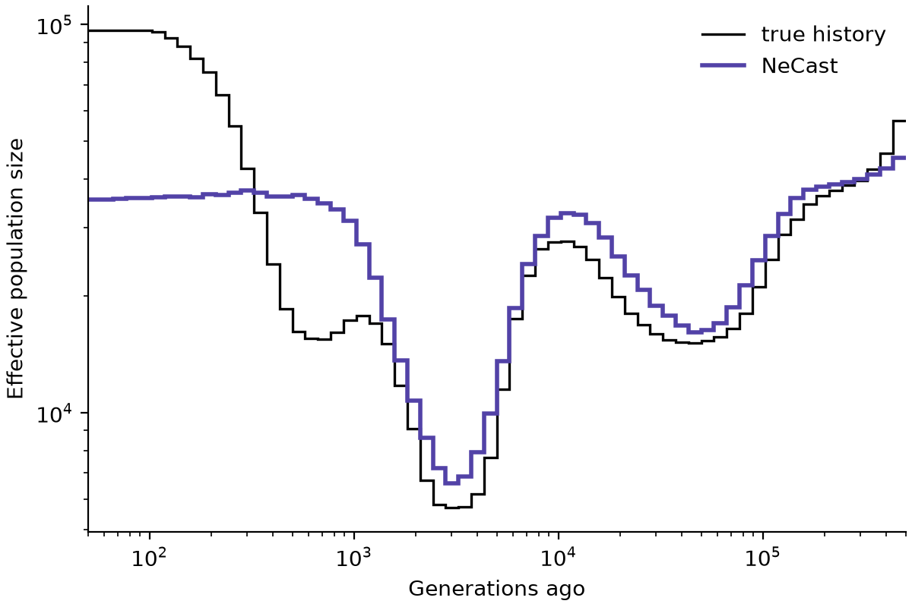

# NeCast

NeCast estimates how the size of a population changed through time, from the
genotypes of 32 individuals. It reads the genome in windows of 30 Mb and gives
the effective population size (Ne) in 64 time intervals, from 50 to 500,000
generations ago. The estimates come from a neural network trained on
simulations that included sequencing errors and variable recombination, so
NeCast reads a recombination map along with the genotypes, and the genotypes
need not be phased.



## Install

NeCast needs Python 3.11 or newer, on Linux or macOS.

```bash
pip install git+https://github.com/larryivan/NeCast
```

## Try it

```bash
necast example
```

This runs NeCast on one simulated window whose true history is known (the
figure above) and writes the results to the folder `necast-example`. It takes
under a minute and ends by saying whether the result is the one expected.

## Run it on your data

Human data on GRCh38, with a file listing 32 or more individuals of one
population:

```bash
necast run data.vcf.gz --mask accessible.bed --samples yri.txt --human --generation-time 29 --out yri
```

`--human` leaves out the assembly gaps and centromeres, and uses the deCODE
recombination map, the Roulette mutation map and a mutation rate of 1.29e-8
per bp per generation, as the paper did.

Other species: give the mutation rate, and a recombination map (`--rec-map`)
or one recombination rate for the whole genome:

```bash
necast run data.vcf.gz --mask accessible.bed --mu 2.8e-9 --rec-rate 1e-8 --out results
```

NeCast needs:

- **32 or more diploid individuals** from one population, ideally unrelated.
  NeCast reads them in groups of 32 and averages over the groups.
- **A VCF or BCF file with an index** (make one with `bcftools index data.vcf.gz`).
  Phased or not; NeCast reads biallelic SNVs that passed the filters.
- **A mask**: a BED file of the sequence where genotypes could be called.
- **Windows of 30 Mb**: a window is 30 Mb of accessible sequence on one
  chromosome, with no masked stretch longer than 1 Mb.
- **The mutation rate**, and a recombination map or rate.

In the folder given by `--out` you get:

| File | Contents |
|---|---|
| `necast.tsv` | the estimate: Ne in each of the 64 time intervals, averaged over windows |
| `windows.tsv` | the estimate of each window and each group of 32 |
| `necast.png` | a figure like the one above |
| `log.txt` | what was read and how long it took |

## Learn more

- [Guide](docs/guide.md): every input, option and output
- [Questions and problems](docs/faq.md)
- [Simulating windows](docs/simulate.md) with `necast simulate`
- The paper's model and data on Hugging Face: [model](https://huggingface.co/Larrivhan/NeCast),
  [simulations](https://huggingface.co/datasets/Larrivhan/NeCast-simulations),
  [benchmark](https://huggingface.co/datasets/Larrivhan/NeCast-benchmark),
  [1000 Genomes estimates](https://huggingface.co/datasets/Larrivhan/NeCast-1000G)

## Citation

Han Y, Wang K. Neural inference of population size history from noisy genotype
data and recombination maps. In preparation.

## Licence

NeCast's code is under the MIT licence. The third-party code and data in
`necast/third_party` keep their own licences; see the README there.
