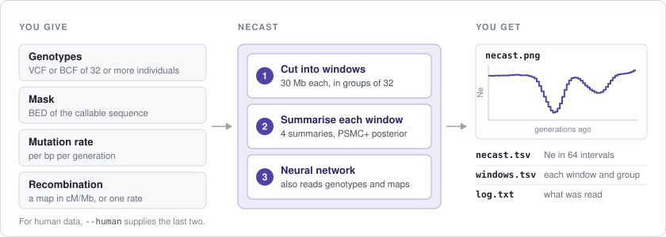

<p align="center">
  
</p>

<h1 align="center">NeCast</h1>

<p align="center">
  Population size history from unphased genotypes and a recombination map
</p>

<p align="center">
  <a href="docs/guide.md">Guide</a> ·
  <a href="docs/faq.md">Questions</a> ·
  <a href="docs/simulate.md">Simulating</a> ·
  <a href="docs/train.md">Training</a>
</p>

<p align="center">
  <a href="https://github.com/larryivan/NeCast/actions/workflows/tests.yml"></a>
  
  
</p>

NeCast estimates how the size of a population changed through time, from the
genotypes of 32 individuals. It reads the genome in windows of 30 Mb and gives
the effective population size (Ne) in 64 time intervals, from 50 to 500,000
generations ago. The estimates come from a neural network trained on
simulations with sequencing errors and variable recombination. NeCast reads a
recombination map along with the genotypes, and the genotypes need not be
phased.

<p align="center">
  
</p>

## Quick start

### 1. Install

NeCast needs Python 3.11 or newer, on Linux or on macOS with Apple silicon.

```bash
pip install git+https://github.com/larryivan/NeCast
```

### 2. Try the example

```bash
necast example
```

This runs NeCast on one simulated window whose true history is known and
writes the results to the folder `necast-example`. It takes under a minute and
ends by saying whether the result is the one expected:

```
necast 0.1.0: 1 group of 32 individuals from 32 samples, chromosome 1, 8 threads
chromosome 1, 1-30,000,000 bp: 95,011 sites
done in 6 s: 1 window; results in necast-example: necast.tsv, windows.tsv, necast.png

Error against the true history: 0.204 (root mean square difference of log10 Ne over the 64 intervals).
NeCast works: the estimate matches the one in necast/example/expected.tsv.
```

<p align="center">
  
  <br>
  <sub>The example's figure: the estimate in purple, the true history in black.</sub>
</p>

### 3. Run it on your data

Human data on GRCh38, with a file listing 32 or more individuals of one
population:

```bash
necast run data.vcf.gz --mask accessible.bed --samples yri.txt \
  --human --generation-time 29 --out yri
```

`--human` leaves out the assembly gaps and centromeres, and uses the deCODE
recombination map, the Roulette mutation map and a mutation rate of 1.29e-8
per bp per generation, as the paper did.

Other species: give the mutation rate, and a recombination map (`--rec-map`)
or one recombination rate for the whole genome:

```bash
necast run data.vcf.gz --mask accessible.bed --mu 1.25e-8 --rec-rate 1e-8 --out results
```

## What you need

| You need | Details |
|:---|:---|
| **32 or more individuals** | Diploid, from one population, ideally unrelated. NeCast reads them in groups of 32 and averages over the groups. |
| **Genotypes** | A VCF or BCF file with an index (make one with `bcftools index data.vcf.gz`). Phased or not; NeCast reads biallelic SNVs that passed the filters. |
| **A mask** | A BED file of the sequence where genotypes could be called. |
| **Windows of 30&nbsp;Mb** | A window is 30 Mb of accessible sequence on one chromosome, with no masked stretch longer than 1 Mb. |
| **Rates** | The mutation rate, and a recombination map or rate. `--human` supplies them for human data on GRCh38. |

The [guide](docs/guide.md#inputs) explains each of them.

## What you get

In the folder given by `--out`:

| File | Contents |
|:---|:---|
| `necast.tsv` | the estimate: Ne in each of the 64 time intervals, averaged over windows |
| `windows.tsv` | the estimate of each window and each group of 32 |
| `necast.png` | a figure like the one above |
| `log.txt` | what was read and how long it took |

The example's `necast.tsv` begins:

```
interval  start_generations  end_generations  ne
1         50                 57.7391          35431.6
2         57.7391            66.6761          35416.7
3         66.6761            76.9963          35556.2
```

## Documentation

| Page | Read it when |
|:---|:---|
| [Guide](docs/guide.md) | you want every option, input and output explained |
| [Questions and problems](docs/faq.md) | NeCast stops with an error, or you wonder whether your data fit |
| [Simulating windows](docs/simulate.md) | you want simulated data with known histories |
| [Training the network](docs/train.md) | you want a network trained on simulations of your own |

The paper's model and data are on Hugging Face:
[model](https://huggingface.co/Larrivhan/NeCast),
[simulations](https://huggingface.co/datasets/Larrivhan/NeCast-simulations),
[benchmark](https://huggingface.co/datasets/Larrivhan/NeCast-benchmark),
[1000 Genomes estimates](https://huggingface.co/datasets/Larrivhan/NeCast-1000G).

## Citation

Han Y, Wang K. Neural inference of population size history from noisy genotype
data and recombination maps. In preparation.

## Licence

NeCast's code is under the MIT licence. In `necast/third_party`, PSMC+'s
`transition_matrix.py` and the maps, histories and gap table come from other
projects and keep their own terms; the README there gives the source and
terms of each.
