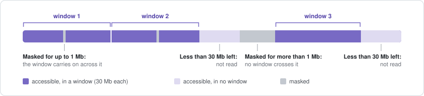
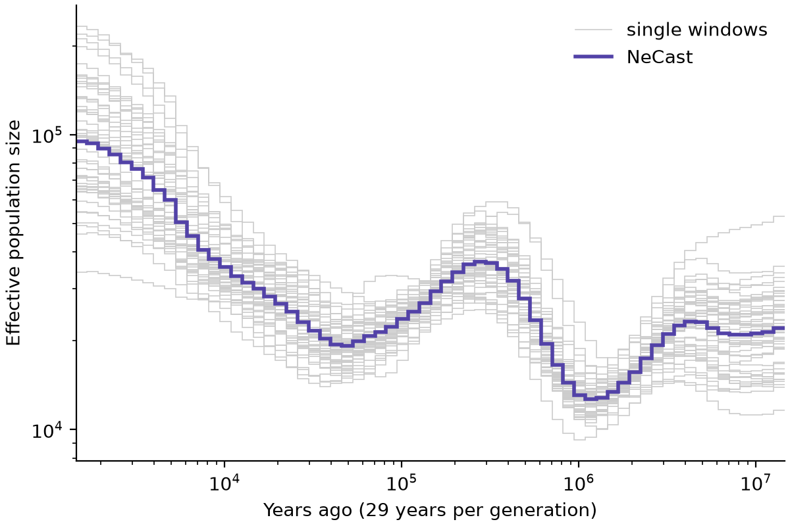
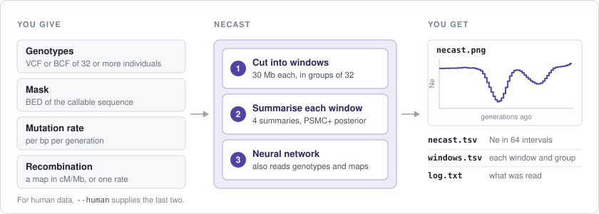

[NeCast](../README.md) · **Guide** · [Questions](faq.md) · [Simulating](simulate.md) · [Training](train.md)

# Guide

Every option, input and output of `necast run`.

```
necast run VCF --mask BED --out FOLDER [options]
```

- [Options](#options)
- [Inputs](#inputs): [genotypes](#genotypes), [individuals](#individuals),
  [mask and windows](#mask-and-windows), [mutation rate](#mutation-rate),
  [recombination](#recombination), [mutation map](#mutation-map),
  [human data](#human-data), [warnings](#warnings)
- [Outputs](#outputs): [necast.tsv](#necasttsv), [windows.tsv](#windowstsv),
  [necast.png](#necastpng), [log.txt](#logtxt),
  [reading the results](#reading-the-results)
- [Time and memory](#time-and-memory)
- [How NeCast works](#how-necast-works)

## Options

| Option | Meaning | Default |
|:---|:---|:---|
| `--mask BED` | the accessible sequence | required |
| `--out FOLDER` | where to write the results | required |
| `--human` | human data on GRCh38: see [Human data](#human-data) | off |
| `--mu RATE` | mutation rate per bp per generation | required; with `--human`, 1.29e-8 |
| `--rec-rate RATE` | one recombination rate per bp per generation for the whole genome | this or `--rec-map` is required unless `--human` |
| `--rec-map BED` | recombination map in cM/Mb, instead of `--rec-rate` | with `--human`, the deCODE map |
| `--mut-map BED` | relative mutation rates along the genome | the same rate everywhere; with `--human`, the Roulette map |
| `--samples FILE` | the individuals to read, one per line | every sample in the VCF |
| `--chromosomes LIST` | chromosomes to read, such as `1,2,3` | every chromosome in both the VCF and the mask except X, Y and the mitochondria; with `--human`, 1 to 22 |
| `--generation-time YEARS` | adds times in years to the table and the figure | times in generations only |
| `--weights FILE` | a network trained with `necast train` | the published network |
| `--threads N` | CPU threads | all |

`necast run --help` prints the same list.

## Inputs

### Genotypes

A VCF or BCF file, compressed with bgzip and indexed (`bcftools index
data.vcf.gz` writes the index). To analyse files split by chromosome
together, join them first with `bcftools concat -Oz -o all.vcf.gz chr1.vcf.gz
chr2.vcf.gz ...` and index the result. NeCast reads, in each window:

- biallelic SNVs whose FILTER is `PASS` or `.`; other records are skipped;
- at a position with two or more such records, none of them;
- diploid genotypes, phased or not. Missing calls (`./.` or `.`) and
  half-missing calls (`0/.`) are allowed. Haploid calls stop the run, so leave
  out chrX in males, chrY and the mitochondria.

The reference allele is taken as the ancestral one, as in the paper's
analysis of the 1000 Genomes Project; the genotypes need no polarisation.

> [!IMPORTANT]
> Filter genotypes by call quality only. Filtering by allele frequency,
> removing singletons or pruning for linkage disequilibrium removes the signal
> NeCast reads.

### Individuals

NeCast reads 32 diploid individuals at a time, because that is what the
network was trained on. They should come from one population and be
unrelated: close relatives share long stretches of their genomes, which looks
like a small recent population (`plink2 --king-cutoff` finds them).

With more than 32 individuals, NeCast reads them in groups of 32 and averages
the groups; individuals left over after the last full group are not read.

| Individuals | Groups of 32 | Not read |
|:---|:---|:---|
| 32 | 1 | 0 |
| 50 | 1 | 18 |
| 64 | 2 | 0 |
| 100 | 3 | 4 |

`--samples` gives the individuals in a text file, one sample name per line, as
in the VCF header. Groups are formed in the order of the file.

> [!NOTE]
> Without `--samples` NeCast reads every sample in the VCF, so make sure they
> all belong to one population.

### Mask and windows

The mask is a BED file (chromosome, start, end; 0-based, end excluded) of the
sequence where genotypes could be called reliably. Sites outside it are not
read, and the bases outside it count neither as variable nor as invariable.
For human data on GRCh38, the [1000 Genomes strict
mask](https://ftp.1000genomes.ebi.ac.uk/vol1/ftp/data_collections/1000G_2504_high_coverage/working/20160622_genome_mask_GRCh38/)
is a good choice; for other species, use the callable regions of your
variant-calling pipeline.

NeCast cuts each chromosome into windows of exactly 30 Mb of accessible
sequence:

<p align="center">
  
</p>

- A window may span masked stretches of up to 1 Mb; a longer one ends the
  current run of sequence.
- Each run is cut from left to right, and a remainder shorter than 30 Mb is
  left out. A chromosome with less than 30 Mb of accessible sequence in one
  run gives no window.
- Inside a window the accessible pieces are joined end to end.
- A window with no site in the VCF (on a chromosome the VCF does not hold, for
  example) is left out, and so is a group of 32 whose individuals vary at no
  site in a window, as when all their calls there are missing; the log says
  so.

Chromosome names may carry `chr` or not: `chr1` and `1` are the same
chromosome in every file.

### Mutation rate

`--mu` is the mutation rate per bp per generation; a rate per year must first
be multiplied by the generation time. NeCast uses it to turn diversity into
population size, so the estimate depends on it: use the best published value
for your species. In tests, a rate off by a factor of 2 moved the estimate by
about 0.2 on the log10 scale and changed its shape as well as its level, so
for a new rate, run NeCast again rather than rescaling a result.

### Recombination

Give either one rate for the whole genome (`--rec-rate`, per bp per
generation) or a map (`--rec-map`). A map is a BED file of rates in cM/Mb:

```
chromosome  start  end    rate
1           0      52000  0.53
1           52000  71400  2.91
```

A map in HapMap format (chromosome, position, rate in cM/Mb, position in cM,
with a header line) becomes such a file with

```bash
awk 'NR > 1 {if ($1 == c) print c "\t" p "\t" $2 "\t" r; c = $1; p = $2; r = $3}' map.txt > map.bed
```

A first line that is not data is skipped. Stretches between rows take the
chromosome's mean rate, and the window ends take the nearest row's rate.
Rates are kept between 0.00001 and 1,000 cM/Mb, the range of the maps in the
training simulations. A masked stretch inside a window keeps its
recombination: NeCast adds it at the point where the accessible pieces join.

A map helps NeCast most for recent times: in the paper's simulations,
without a map, sizes 50 to 500 generations ago came out about 1.7 times too
low. When no map exists, the average rate of the species is much less
critical than the mutation rate: an average off by a factor of 2 moved the
estimate by about 0.06 on the log10 scale.

### Mutation map

`--mut-map` is a BED file of relative mutation rates along the genome, in the
same format. Only its shape is used: in each window the rates are scaled so
that their mean is `--mu`. Without it the mutation rate is the same
everywhere.

### Human data

`--human` is for human data on GRCh38. It

- leaves out the assembly gaps and the centromeres;
- uses, unless you give your own, the deCODE recombination map
  (Halldorsson et al. 2019), the Roulette mutation map (Seplyarskiy et al.
  2023) and `--mu 1.29e-8`;
- reads chromosomes 1 to 22 only (it stops if `--chromosomes` names
  another), and stops if the VCF gives them lengths other than GRCh38's.

These are the settings of the paper's 1000 Genomes analysis. The paper also
left out two regions under strong selection on chromosome 2, around EDAR
(108.8-109.0 Mb) and LCT (135.8-137.2 Mb); to do the same, remove them from
the mask.

### Warnings

NeCast warns when the data are unlike the training simulations, where the
estimates are less certain:

- a mutation rate outside 6.25e-9 to 2.5e-8;
- a window whose mean recombination rate is outside 1.7e-9 to 3e-8 per bp;
- a group with more than 2% of its allele calls missing.

The run goes on; the warnings are in `log.txt`.

## Outputs

NeCast writes four files to the folder given by `--out`.

### necast.tsv

The estimate, one row per time interval:

| Column | Meaning |
|:---|:---|
| `interval` | 1 to 64, from recent to ancient |
| `start_generations`, `end_generations` | the interval, in generations before the present |
| `start_years`, `end_years` | the same in years, with `--generation-time` |
| `ne` | the effective population size in the interval |

The intervals are equally spaced on a log scale between 50 and 500,000
generations. `ne` is the geometric mean over windows and groups: the mean of
log10 Ne, raised back to a size.

### windows.tsv

One row per window and group of 32: `chromosome`, `start`, `end` (the
window's span on the chromosome, 0-based, end excluded), `group`, and `ne_1`
to `ne_64`. Windows give noisy estimates on their own; their spread shows how
much the estimate varies along the genome.

### necast.png

Every window's estimate in grey and their mean in purple, on log scales.

<p align="center">
  
  <br>
  <sub>The paper's estimate for the Yoruba (YRI) of the 1000 Genomes Project, drawn the same way: 51 windows in grey and their mean in purple.</sub>
</p>

### log.txt

Everything NeCast printed during the run: what was read, each window, the
warnings and the time taken. A new run in the same folder adds to the file.

### Reading the results

In Python:

```python
import pandas as pd
estimate = pd.read_csv("results/necast.tsv", sep="\t")
```

In R:

```r
estimate <- read.delim("results/necast.tsv")
```

## Time and memory

A window of 32 individuals takes a few seconds to estimate with 16 CPU
threads, and about half a minute with one; most of it goes to the PSMC+
posterior. The run needs about 4 GB of memory.

Reading the VCF can take longer than that when the file holds many more
samples than the ones read: a window of the 1000 Genomes 30x panel, with
3,202 samples, took about a minute in all.

> [!TIP]
> To run several analyses on the same individuals, extract them once with
> `bcftools view -S samples.txt -Oz -o mine.vcf.gz data.vcf.gz` and index the
> result.

## How NeCast works

<p align="center">
  
</p>

For each window and group of 32, NeCast computes four summaries of the
genotypes (the folded site-frequency spectrum, linkage disequilibrium by
genetic distance, the lengths of identical-by-state tracts between pairs of
individuals, and Watterson's estimate) and the posterior of coalescence times
from PSMC+ (Cousins et al. 2024). The network reads these together with the
genotypes and the maps, and returns Ne in the 64 intervals. The paper
describes the method and how it was tested.
