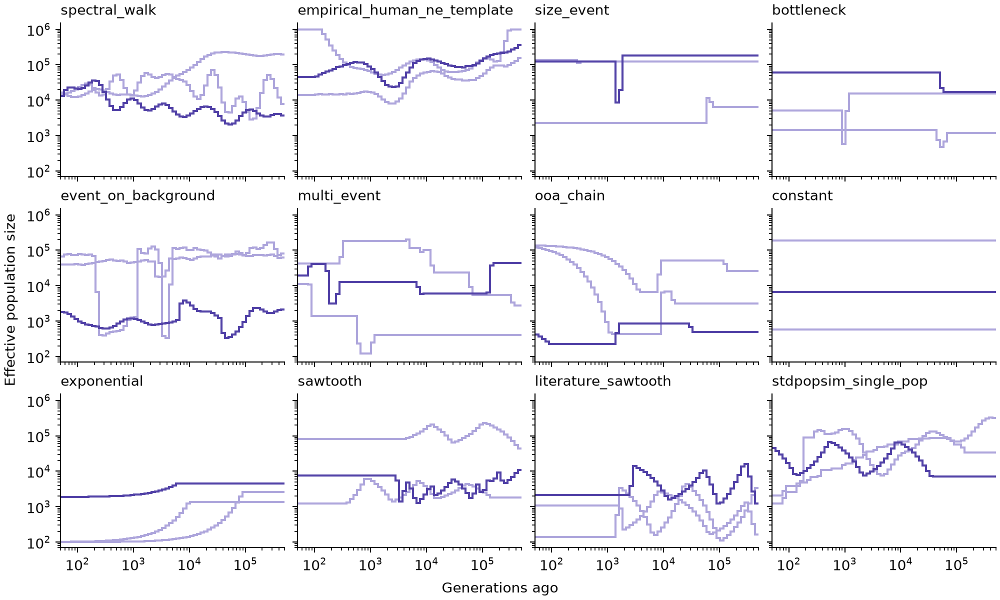

[NeCast](../README.md) · [Guide](guide.md) · [Questions](faq.md) · **Simulating** · [Training](train.md)

# Simulating windows

`necast simulate` makes simulated windows like the ones NeCast was trained and
tested on: genotypes of a sample of individuals, the maps a method would be
given, and the true size history.

- [Quick start](#quick-start)
- [Options](#options)
- [What a dataset holds](#what-a-dataset-holds)
- [What a window can be](#what-a-window-can-be): [size histories](#size-histories),
  [maps](#maps), [sequencing errors](#sequencing-errors)
- [Simulating a history of your own](#simulating-a-history-of-your-own)
- [The data that ships with the package](#the-data-that-ships-with-the-package)
- [Tests](#tests)

## Quick start

The simulator needs a few extra packages:

```bash
pip install "necast[simulate] @ git+https://github.com/larryivan/NeCast"
```

Then simulate:

```bash
necast simulate --preset mini --n-samples 20 --out-dir simulations
```

This writes 20 windows of 1 Mb with 12 individuals each, in about a minute.

## Options

A preset sets the size of the dataset. The paper's windows are made with
`--preset full_v01`: 30 Mb and 64 individuals.

| Preset | Windows | Length | Individuals |
|:---|:---|:---|:---|
| `mini` | 512 | 1 Mb | 12 |
| `core_v01` | 20,000 | 10 Mb | 32 |
| `full_v01` | 100,000 | 30 Mb | 64 |

`--n-samples` overrides the number of windows. Other options used often:

| Option | Meaning |
|:---|:---|
| `--out-dir FOLDER` | where to write the windows |
| `--seed N` | random seed; the same seed gives the same windows on the same kind of machine |
| `--workers N` | processes to use; -1 means all CPUs but one |
| `--include-truth` | also store the true maps the data were simulated with, for 2% of the windows (`--truth-fraction` sets the share); for analysis only, never as input to a method |
| `--force` | delete an earlier dataset in `--out-dir` and start again |

`necast simulate --help` lists every option. A run that stops can be started
again with the same command: it continues where it stopped.

## What a dataset holds

```
simulations/
  samples/shard_00000.npz        the windows, as arrays, up to 128 a file (32 with mini)
  samples/shard_00000.jsonl.gz   one line of metadata per window
  metadata/samples.csv           the metadata of all windows in one table
  config.json  manifest.json     the settings that made the dataset
  scripts/loader.py              a short reader, written beside the data
```

In a `.npz` file the windows are stored one after another, and the
`*_offsets` arrays say where each window starts. For window `row`:

```python
import numpy as np

shard = np.load("simulations/samples/shard_00000.npz")
row = 0
lo, hi = shard["variant_offsets"][row], shard["variant_offsets"][row + 1]

target    = shard["target_log10_ne"][row]         # (64,) true log10 Ne in each time interval
positions = shard["variant_positions_bp"][lo:hi]  # positions of the variable sites
packed    = shard["genotype_packed"][lo:hi]       # genotypes, 8 chromosome copies per byte
n_haplotypes = int(shard["n_haplotypes"][0])
haplotypes = np.unpackbits(packed, axis=1, bitorder="little")[:, :n_haplotypes]
```

The 64 time intervals are spaced evenly on a log scale from 50 to 500,000
generations; `time_edges` in `manifest.json` gives their boundaries.
Haplotypes `2i` and `2i + 1` belong to individual `i`. Missing calls are
stored as indices into the window's flattened sites × haplotypes array
(`missing_flat_idx`, sliced by `missing_offsets`).

A map is stored as breakpoints (`*_pos`) and the rates between them
(`*_rate`), so a window has one rate fewer than breakpoints:

```python
offsets = shard["obs_rec_offsets"]
lengths = np.diff(offsets.astype(np.int64))
rate_at = np.concatenate(([0], np.cumsum(np.maximum(lengths - 1, 0))))

breakpoints = shard["obs_rec_pos"][offsets[row]:offsets[row + 1]]
rates       = shard["obs_rec_rate"][rate_at[row]:rate_at[row + 1]]
```

`obs_rec_*` and `obs_mut_*` are the maps a method would be given in practice:
a published map's resolution, its errors and an error in its overall level.
With `--include-truth`, a fixed 2% of the windows also hold `true_rec_*` and
`true_mut_*`, the maps the sequence was actually simulated under; the others
hold empty arrays, and `--truth-fraction 1` stores them for every window.

> [!IMPORTANT]
> Use the observed maps as input; the true ones are for measuring how much map
> errors matter.

## What a window can be

Each window draws a size history and a pair of maps independently, so any
history can appear with any map.

### Size histories

<p align="center">
  
  <br>
  <sub>Three histories of each kind, drawn as <code>--preset full_v01</code> draws them.</sub>
</p>

| Kind | Share | What it is |
|:---|:---|:---|
| `spectral_walk` | 0.200 | a smooth random history, whose roughness and range are drawn too |
| `empirical_human_ne_template` | 0.190 | one of 191 histories inferred from real human data (SMC++, phlash, MSMC2, MSMC-IM), shifted, stretched and with noise added |
| `size_event` | 0.100 | one change of size, which may be permanent |
| `bottleneck` | 0.100 | a drop of 0.4 to 3 orders of magnitude, then recovery |
| `event_on_background` | 0.086 | a quieter smooth history with one or two sharp events |
| `multi_event` | 0.080 | two to four changes of size |
| `ooa_chain` | 0.080 | like the human out-of-Africa history: expansion, bottleneck, then growth |
| `constant` | 0.040 | one size throughout |
| `exponential` | 0.040 | steady exponential growth or decline |
| `sawtooth` | 0.030 | repeated rise and fall |
| `literature_sawtooth` | 0.030 | zigzags like the one of Schiffels and Durbin: rises and falls of about tenfold, about fourfold apart in time, with a random number of them |
| `stdpopsim_single_pop` | 0.024 | the 18 published single-population histories of the stdpopsim catalogue, across 8 species; three are multiplied by one constant to keep their sizes within 100 to 1,000,000 |

Sizes range from 100 to 1,000,000. The kind of each window is in the
`generator_recipe` column of `metadata/samples.csv`. The
`held_out_evaluation` column marks the stdpopsim histories, but `necast train`
does not read it and fits them like the other kinds.

### Maps

| Kind | Share | What it is |
|:---|:---|:---|
| `custom_heterogeneous` | 0.55 | synthetic: a smoothly varying rate with sharp recombination hotspots, matched to the deCODE map |
| `empirical_map_slice` | 0.20 | a stretch of the real deCODE and Roulette maps, both taken from the same place in the genome |
| `random_global_mu_r` | 0.15 | constant rates: recombination 0.3 to 3 times the baseline, mutation 0.5 to 2 times |
| `clean_constant_map` | 0.10 | constant rates at the baseline, with no map error and no sequencing errors |

These are the shares of `full_v01`; `mini` and `core_v01` use 0.35, 0.20, 0.20
and 0.25. The kind of each window is in the `source_type` column. For the two
kinds whose rates vary, the observed map differs from the true one by an error
that is partly shared by neighbouring regions, as real maps disagree with each
other; for the two constant kinds it is the true map.

### Sequencing errors

Windows other than `clean_constant_map` also carry invented variable sites,
wrong genotype calls, missing calls and phasing mistakes, each at a rate
drawn per window between a minimum and a maximum:

| Error | Options |
|:---|:---|
| invented variable sites | `--false-variant-rate-per-bp-min`, `--false-variant-rate-per-bp-max` |
| wrong genotype calls | `--genotype-error-min`, `--genotype-error-max` |
| missing calls | `--missing-rate-min`, `--missing-rate-max` |
| phasing mistakes | `--phase-switch-rate-per-het-min`, `--phase-switch-rate-per-het-max` |

## Simulating a history of your own

Write the history as a table with one row per period, starting at the
present:

```
species,model_id,population,generation_time_years,epoch_index,start_generations_ago,size,growth_rate_per_generation
HomSap,MyHistory,pop_0,25.0,0,0.0,10000.0,0.0
HomSap,MyHistory,pop_0,25.0,1,2000.0,2000.0,0.0
HomSap,MyHistory,pop_0,25.0,2,4000.0,20000.0,0.0
```

and draw every window from it, as the benchmark of the paper did:

```bash
necast simulate --preset full_v01 --n-samples 100 --out-dir mine --seed 1 \
  --p-constant 0 --p-spectral-walk 0 --p-size-event 0 --p-multi-event 0 \
  --p-exponential 0 --p-sawtooth 0 --p-literature-sawtooth 0 --p-bottleneck 0 \
  --p-event-on-background 0 --p-ooa-chain 0 --p-empirical-human-ne-template 0 \
  --p-stdpopsim-single-pop 1 --stdpopsim-template-path my_history.csv
```

Three things to know:

- a history whose sizes fall outside 100 to 1,000,000 is multiplied by one
  constant to fit (each window records the factor as `stdpopsim_ne_rescale`);
- a history whose largest size is more than 10,000 times its smallest cannot
  be fitted and stops the run;
- a table with several models gives each window one of them at random.

## The data that ships with the package

The maps and the inferred histories the simulator draws from are in
`necast/third_party`; its [README](../necast/third_party/README.md) says where
each came from.

## Tests

```bash
pip install -e ".[simulate,dev]"
python -m pytest
```

The whole suite takes about 15 minutes. Many tests compare the simulator with
published numbers: the hotspot widths of the synthetic maps against deCODE,
the turning points of the histories against the 191 inferred ones, the errors
of the observed maps against the disagreement between two published maps.
Eleven tests compare floating-point values exactly with values recorded on
macOS (Apple silicon) and fail on Linux by a few units in the last place.
